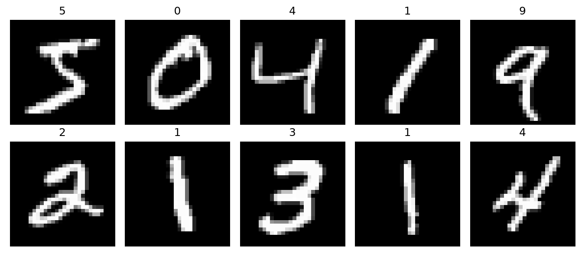
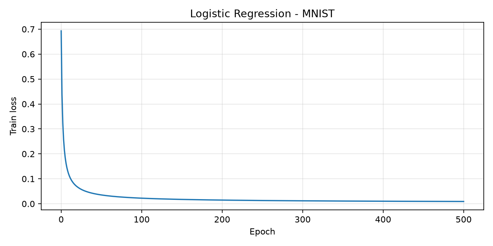
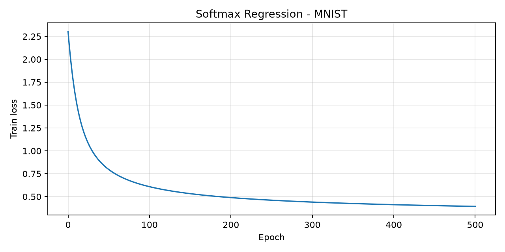
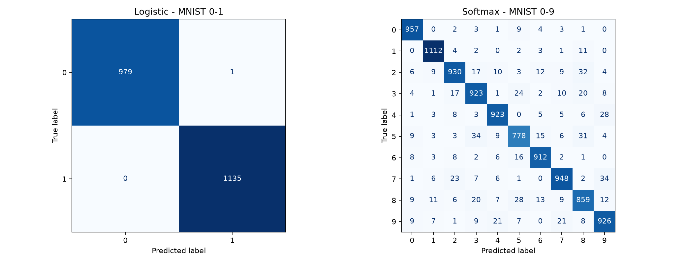

# Lab 2 — Logistic Regression và Softmax Regression trên MNIST

- **Sinh viên:** Nguyễn Quốc Nam
- **MSSV:** 24521118
- **Lớp học phần:** DS102.R11.CNVN.2
- **Môn học:** Học máy thống kê

## 1. Nội dung

| Nội dung                                                           | File                                                               |
| ------------------------------------------------------------------ | ------------------------------------------------------------------ |
| Tải và chuẩn bị MNIST                                              | [00_chuan_bi_du_lieu_MNIST.ipynb](00_chuan_bi_du_lieu_MNIST.ipynb) |
| Bài 1: Logistic Regression bằng NumPy, phân loại chữ số 0 và 1     | [01_bai1_logistic_numpy.ipynb](01_bai1_logistic_numpy.ipynb)       |
| Bài 2: Softmax Regression bằng NumPy, phân loại chữ số 0–9         | [02_bai2_softmax_numpy.ipynb](02_bai2_softmax_numpy.ipynb)         |
| Bài 3: Logistic Regression và Softmax Regression bằng Scikit-learn | [03_bai3_scikit_learn.ipynb](03_bai3_scikit_learn.ipynb)           |
| Đề bài                                                             | [assignments.ipynb](assignments.ipynb)                             |
| Lý thuyết                                                          | [preliminaries.ipynb](preliminaries.ipynb)                         |

Bài 1 và Bài 2 tự xây dựng mô hình bằng NumPy, huấn luyện bằng Gradient Descent, đánh giá Precision, Recall, F1 và vẽ đồ thị loss. Bài 3 sử dụng thư viện trên cùng các tập dữ liệu tương ứng.

## 2. Các file chính trong repository

```text
.
├── README.md
├── requirements.txt
├── .gitignore
├── assignments.ipynb
├── preliminaries.ipynb
├── 00_chuan_bi_du_lieu_MNIST.ipynb
├── 01_bai1_logistic_numpy.ipynb
├── 02_bai2_softmax_numpy.ipynb
├── 03_bai3_scikit_learn.ipynb
├── data/
│   ├── README.md
│   ├── source.json
│   └── sample_images.png
└── results/
    ├── bai1_logistic_numpy/
    ├── bai2_softmax_numpy/
    └── bai3_scikit_learn/
```

`data/` chứa thông tin nguồn và ảnh mẫu. `results/` chứa các chỉ số đánh giá, đồ thị, mô hình đã lưu và dự đoán trên tập test.

## 3. Cách chạy

Cài thư viện từ thư mục chứa [requirements.txt](requirements.txt):

```bash
python -m pip install -r requirements.txt
```

Mở các notebook bằng VS Code với extension Python và Jupyter. Chọn môi trường Python đã cài thư viện và chạy **Run All** theo thứ tự:

1. `00_chuan_bi_du_lieu_MNIST.ipynb`
2. `01_bai1_logistic_numpy.ipynb`
3. `02_bai2_softmax_numpy.ipynb`
4. `03_bai3_scikit_learn.ipynb`

Notebook 00 tải dữ liệu MNIST và tạo file dữ liệu cho ba notebook làm bài. Cần Internet trong lần tải đầu tiên. Các file dữ liệu tải về được loại khỏi Git bằng [.gitignore](.gitignore), vì vậy cần chạy notebook 00 sau khi tải repository.

Chạy notebook từ thư mục bài làm hoặc thư mục cha chứa `Lab2_du_lieu_MNIST`. Kết quả cũng đã được lưu trong notebook để xem trực tiếp trên GitHub.

## 4. Dữ liệu và tiền xử lý

Nguồn dữ liệu: [MNIST được dẫn trong đề bài](https://github.com/cvdfoundation/mnist).

- Ảnh xám kích thước **28 × 28**, trải phẳng thành **784** đặc trưng.
- Giữ nguyên tập **60.000 ảnh train** và **10.000 ảnh test** chuẩn.
- Chuyển pixel sang số thực và chia cho **255.0** để đưa về khoảng [0, 1].
- Bài 1 lọc chữ số 0, 1; Bài 2 dùng đủ 10 chữ số. Bài 3 sử dụng đúng các tập tương ứng.

| Bài toán               |  Train |   Test | Số lớp |
| ---------------------- | -----: | -----: | -----: |
| Logistic — chữ số 0, 1 | 12.665 |  2.115 |      2 |
| Softmax — chữ số 0–9   | 60.000 | 10.000 |     10 |

Thông tin nguồn và mã kiểm tra các file tải về nằm trong [data/source.json](data/source.json).



## 5. Cấu hình mô hình

| Mô hình               | Hàm xác suất         | Tối ưu                      | Cấu hình                                                    |
| --------------------- | -------------------- | --------------------------- | ----------------------------------------------------------- |
| Logistic NumPy        | Sigmoid              | Full-batch Gradient Descent | Learning rate 0.1, 500 epoch, ngưỡng 0.5                    |
| Softmax NumPy         | Softmax              | Full-batch Gradient Descent | Learning rate 0.1, 500 epoch, chọn lớp có xác suất lớn nhất |
| Logistic Scikit-learn | Logistic nhị phân    | L-BFGS                      | C=1.0, max_iter=1000, tol=1e-4                              |
| Softmax Scikit-learn  | Multinomial logistic | L-BFGS                      | C=1.0, max_iter=1000, tol=1e-4                              |

Hai mô hình NumPy dùng cross-entropy và khởi tạo trọng số bằng 0. Mô hình Scikit-learn có L2 regularization, còn mô hình NumPy không có phần phạt trọng số. Số vòng lặp L-BFGS khác số epoch Gradient Descent.

## 6. Kết quả

Precision, Recall và F1 trong bảng là **macro average**, làm tròn 4 chữ số thập phân. Chỉ số từng lớp có trong các notebook và file báo cáo.

| Mô hình                 | Accuracy | Macro Precision | Macro Recall | Macro F1 |
| ----------------------- | -------: | --------------: | -----------: | -------: |
| Logistic - NumPy        |   0.9991 |          0.9991 |       0.9990 |   0.9990 |
| Logistic - Scikit-learn |   0.9995 |          0.9996 |       0.9995 |   0.9995 |
| Softmax - NumPy         |   0.9011 |          0.9001 |       0.8997 |   0.8996 |
| Softmax - Scikit-learn  |   0.9268 |          0.9258 |       0.9257 |   0.9257 |

Bảng đầy đủ: [comparison.csv](results/bai3_scikit_learn/comparison.csv).

### Loss của các mô hình NumPy

| Mô hình        | Loss ban đầu | Loss sau 500 epoch |
| -------------- | -----------: | -----------------: |
| Logistic NumPy |     0.693147 |           0.009127 |
| Softmax NumPy  |     2.302585 |           0.393250 |





### Ma trận nhầm lẫn của Scikit-learn

Hàng là nhãn thật, cột là nhãn dự đoán.



## 7. Các file kết quả

| Vị trí                                                                             | Nội dung                                                     |
| ---------------------------------------------------------------------------------- | ------------------------------------------------------------ |
| [results/bai1_logistic_numpy/](results/bai1_logistic_numpy/)                       | Chỉ số đánh giá, loss, mô hình NumPy và dự đoán chữ số 0–1   |
| [results/bai2_softmax_numpy/](results/bai2_softmax_numpy/)                         | Chỉ số đánh giá, loss, mô hình NumPy và dự đoán đủ 10 chữ số |
| [classification_reports.txt](results/bai3_scikit_learn/classification_reports.txt) | Precision, Recall, F1 từng lớp của hai mô hình Scikit-learn  |
| [comparison.csv](results/bai3_scikit_learn/comparison.csv)                         | Bảng tổng hợp kết quả bốn mô hình                            |
| [metrics.json](results/bai3_scikit_learn/metrics.json)                             | Chỉ số, ma trận nhầm lẫn và cấu hình Scikit-learn            |
| [models.joblib](results/bai3_scikit_learn/models.joblib)                           | Hai mô hình Scikit-learn đã huấn luyện                       |

Các file dự đoán gồm hai cột `true_label` và `predicted_label`. Các hình và chỉ số cũng có thể xem ở phần cuối mỗi notebook làm bài.
